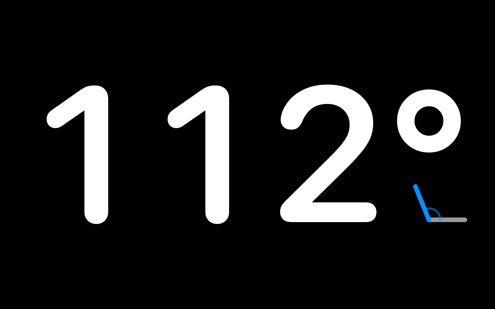
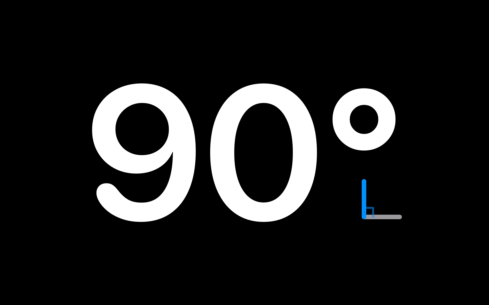
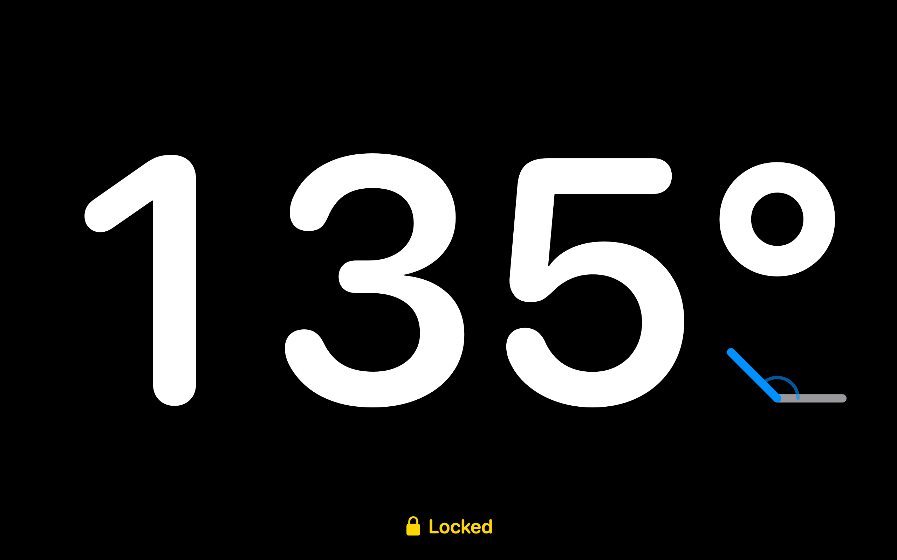

# MacBook Protractor

Shows the MacBook lid angle from the built-in hinge sensor, as a large number on a black screen.



| Right angle | Locked |
| --- | --- |
|  |  |

## Run

Needs macOS 14+ and a MacBook with a lid angle sensor (2019 MacBook Pro 16" and later; some M1 models do not have one).

```sh
swift run MacBookProtractor               # window + menu bar item
swift run MacBookProtractor --fullscreen  # start in full screen
swift run MacBookProtractor --once        # print the angle and exit
swift test
```

## Controls

- **Space** - tap to lock, tap again to unlock; hold to lock only while held (with a sound on lock and unlock)
- **Double-click** or **Ctrl-Cmd-F** - toggle full screen
- **Menu bar item** - lock, full screen, quit
- **Stand the Mac on a side edge** (like a book) - the UI turns to stay upright

## How it works

The sensor is a HID device (vendor `0x05AC`, product `0x8104`, usage page `0x20`, usage `0x8A`).
The app reads feature report 1 at 120 Hz on a background queue. Bytes 1-2 are the angle in degrees (little-endian `UInt16`).

Auto-rotate uses the built-in accelerometer (usage page `0xFF00`, usage `3`, Apple Silicon only).
The app turns its SPU driver on at 100 Hz while it runs and off when it quits.
